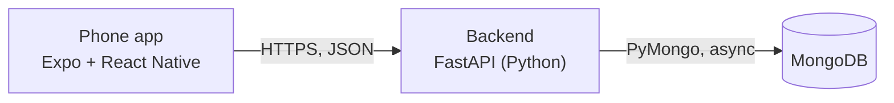

# Flat Split

Let flatmates record shared expenses and see what each person owes.

Built with [Naapy](https://www.na-apy.com): a phone app and the backend it talks to,
in one repository.

- [About this app](#about-this-app)
- [What's in version 1](#whats-in-version-1)
- [Not in version 1](#not-in-version-1)
- [Architecture](#architecture)
- [Folder structure](#folder-structure)
- [API](#api)
- [Testing report](#testing-report)
- [Run it locally](#run-it-locally)
- [Deploy](#deploy)
- [Before you go live](#before-you-go-live)
- [Handing this to a client](#handing-this-to-a-client)
- [How Naapy pushes](#how-naapy-pushes)

## About this app

**Who it's for:** flatmate

## What's in version 1

Each feature is listed with what Naapy can say about it. **Built** means the code for it exists and the build's final checks passed (the testing report lists which ran). The checks never tap through the screens, so try each feature yourself before you rely on it.

- **Flatmates can sign in with email.**
  - A flatmate can sign in using an email address and access the shared expenses. — _Built_
- **A flatmate can add an expense with an amount, a category of rent, groceries or bills, and who paid.**
  - An expense can be saved only when it has an amount, one of the three stated categories, and a selected payer. — _Built_
  - The saved expense appears in the shared expense list. — _Built_
  - The selected payer must be one of the flatmates sharing the expense. — _Built_
- **Every flatmate can see the shared list of expenses.**
  - Each signed-in flatmate in the shared flat sees its recorded expenses with amount, category, and payer. — _Built_
- **Every flatmate can see what each person owes.**
  - The app shows a balance for each flatmate based on the shared expenses. — _Built_
  - Each expense is divided equally among the flatmates; each person's balance is their total share minus the total they paid. — _Built_
  - A positive balance is shown as owed, a negative balance as owed to that person, and a zero balance as settled. — _Built_
- **Expenses and balances are shared among the flatmates of the same flat.**
  - Flatmates associated with the same flat see the same expenses and balances. — _Built_
  - Flatmates are already associated with one shared flat when they use the app. — _Built_
- **The expense screen handles a flat with no recorded expenses.**
  - Before any expense is added, the list shows that there are no expenses and each flatmate's balance is zero. — _Built_

In numbers: 11 built.

## Not in version 1

Ideas and limits recorded while this app was planned: a starting list for the next version.

**Left out of scope:**

- Editing or deleting expenses
- Payment collection or settlement tracking
- Custom expense categories or split rules
- Invitations and management of multiple flats

## Architecture



| Part | Folder | Built with |
|---|---|---|
| Phone app | `mobile/` | Expo SDK 57, React Native 0.86.3, TypeScript, React Navigation, TanStack Query, HeroUI Native |
| Backend | `api/` | Python, FastAPI, Pydantic, Uvicorn |
| Database | — | MongoDB: on your machine, in Docker, or MongoDB Atlas |

The phone app never touches the database. Every screen reads and writes through the backend's HTTP endpoints, and the backend is the only part holding the database password.

Ready-made building blocks in this app:

- **Sign-in and user roles** — `api/routers/auth.py`, `mobile/src/providers/auth/`
- **Sign-in screen in front of the app** — `mobile/src/providers/auth/AuthGate.tsx`

## Folder structure

```text
.
├── api/                     Backend (Python, FastAPI)
│   ├── routers/             The endpoints, one file per resource
│   ├── config.py            Settings, read from environment variables
│   ├── database.py          MongoDB connection
│   ├── main.py              Entry point: routers, CORS, health check
│   ├── requirements.txt     Python dependencies
│   └── schemas.py           Request and response models
├── mobile/                  Phone app (Expo, React Native)
│   ├── assets/              Icons, splash screen, fonts
│   ├── src/                 App source
│   │   ├── components/      Shared UI components
│   │   ├── config/          The backend's address
│   │   ├── hooks/           Data fetching, one hook per API call
│   │   ├── lib/             Shared helpers
│   │   ├── navigation/      Tabs and stacks
│   │   ├── providers/       App-wide providers (data cache, sign-in)
│   │   ├── screens/         One file per screen
│   │   ├── theme/           Colours, fonts, spacing
│   │   ├── types/           API request and response types
│   │   └── uniwind.d.ts
│   ├── style-pack/
│   ├── app.json             App name, icon, bundle ids
│   ├── App.tsx              Root component
│   ├── babel.config.js
│   ├── eas.json             Build profiles for Expo's build service
│   ├── global.css
│   ├── index.ts
│   ├── metro.config.js
│   ├── package-lock.json
│   ├── package.json         JavaScript dependencies
│   ├── theme.generated.css
│   └── tsconfig.json
└── README.md                This file
```

**Screens** (`mobile/src/screens/`): `AccountScreen`, `AuthGateScreen`, `HomeScreen`, `ItemFormScreen`

## API

While the backend runs, open `http://localhost:8003/docs` for interactive docs of every endpoint
(you can send real requests from that page), or `/openapi.json` for the raw OpenAPI document.

### How the app talks to the backend

- `mobile/src/config/api.ts` creates the one HTTP client every call goes through. Its address comes from `EXPO_PUBLIC_API_BASE_URL`; without it the app calls `http://localhost:8003` (`http://10.0.2.2:8003` on the Android emulator, which is how the emulator reaches your computer).
- `mobile/src/types/api.ts` holds the request and response types, matching the backend's models.
- `mobile/src/hooks/` wraps each call in a TanStack Query hook; the screens use the hooks, never the client directly.
- On the backend, `api/main.py` registers one router per resource from `api/routers/`.

## Testing report

Before handing this build over, Naapy ran its automatic checks on it: the ones below are the final round's.
The build's final checks **passed**.

<details>
<summary>The final round of checks: 7 passed, 2 not run</summary>

| Check | Result |
|---|---|
| Mobile Expo Config | Passed |
| Scaffold Cleanup | Not run |
| Mobile TypeScript | Passed |
| Frontend Contract | Passed |
| Frontend Off-Catalog Imports | Passed |
| Kit Discipline | Passed |
| Capability Modules | Passed |
| Provider Wiring | Passed |
| Screen Check | Not run |

</details>

The backend did not change in the final round, so its checks ran earlier in this build and are not repeated here.

What these checks do not cover: tapping through the screens, and anything that needs a real device (camera, notifications, location). Try those by hand.

## Run it locally

You need Node.js 22, Python 3.11 (3.10 to 3.12 work; the backend's pinned packages have no
builds for newer ones), and a MongoDB database: a free
[MongoDB Atlas](https://www.mongodb.com/atlas) cluster, or one on your machine with
`docker run -d -p 127.0.0.1:27017:27017 mongo:7`.

### 1. Start the backend

```bash
cd api
python3.11 -m venv .venv
source .venv/bin/activate        # Windows: .venv\Scripts\activate
pip install -r requirements.txt
```

Create `api/.env` with your database:

```bash
MONGODB_URL=mongodb://localhost:27017
MONGODB_DATABASE=my_app
```

Then start it on port 8003, the port the phone app looks for by default:

```bash
uvicorn main:app --reload --host 0.0.0.0 --port 8003
```

`http://localhost:8003/api/health` answers when it is up.

### 2. Start the phone app

```bash
cd mobile
npm ci
npx expo start
```

Press `w` to open it in a browser or `a` for the Android emulator, or scan the QR code with
the Expo Go app on your phone. On a real phone, `localhost` means the phone itself, so start the
app with your computer's address on the local network instead:

```bash
EXPO_PUBLIC_API_BASE_URL=http://192.168.1.20:8003 npx expo start
```

### Settings

| Setting | Part | What it is |
|---|---|---|
| `MONGODB_URL` | backend | Database connection string (`mongodb://…` or `mongodb+srv://…`) |
| `MONGODB_DATABASE` | backend | Database name |
| `CORS_ALLOW_ORIGINS` | backend | Which websites may call the API from a browser; `*` (any) by default |
| `EXPO_PUBLIC_API_BASE_URL` | phone app | The backend's address, fixed into the app when it is bundled |

Every backend setting is in `api/config.py` and can come from the environment or `api/.env`.

## Deploy

### Database

Create a MongoDB Atlas cluster (the free tier is enough to start), add a database user, allow
connections from your backend host, and copy the `mongodb+srv://…` connection string.

### Backend

Any host that runs Python works: Render, Railway, Fly.io, or your own server. They all need the
same four answers:

- **Root directory:** `api`
- **Build command:** `pip install -r requirements.txt`
- **Start command:** `uvicorn main:app --host 0.0.0.0 --port $PORT`
- **Environment variables:** `MONGODB_URL`, `MONGODB_DATABASE`, and `CORS_ALLOW_ORIGINS` if you
  publish the web version
- **Python version:** 3.11. `api/.python-version` asks for it, and most hosts read that file; on
  one that does not, set it in the host's settings (on Render, `PYTHON_VERSION=3.11.11`)

Check `https://<your-backend>/api/health` once it is live.

### Phone app

The app builds with Expo's build service (EAS); the build profiles are in `mobile/eas.json`.

1. Check the app's name and its ids in `mobile/app.json`. Naapy filled them in for this app;
   `ios.bundleIdentifier` and `android.package` cannot change once the app is in a store.
2. In `mobile/eas.json`, give each profile you build your live backend's address:
   `"env": { "EXPO_PUBLIC_API_BASE_URL": "https://<your-backend>" }`.
3. Link the app to your Expo account and build.

```bash
cd mobile
npm install -g eas-cli
eas login
eas init
eas build -p android --profile preview      # an APK you install on Android phones directly
eas build -p android --profile production   # for Google Play
eas build -p ios --profile production       # for the App Store (needs an Apple Developer account)
eas submit -p android                       # or -p ios: sends the build to the store
```

Expo's guide covers each step in detail: https://docs.expo.dev/build/setup/

## Before you go live

- **Sign-in emails need your own email provider.** Verification and password-reset codes are sent through Naapy's email relay, which only answers inside Naapy's hosted preview. Anywhere else, asking for a verification code fails with "Email is not available", and a password reset says a code is on its way but sends nothing. Connect a provider (Resend, Postmark, SendGrid…) in `_send_app_email` in `api/routers/auth.py`.
- **Lock down the database.** Give the backend its own database user with a strong password,
  and allow connections only from your backend host.
- **Restrict `CORS_ALLOW_ORIGINS`** to your own site if you publish the web version. The
  default `*` lets any website call your API from a browser.
- **Hide the route list.** `/debug/routes` in `api/main.py` lists every endpoint to anyone who
  asks; Naapy's checks use it. Delete it, or keep it off the public internet.
- **Keep secrets out of git.** `.env` files are already ignored; put production values in your
  host's environment settings.
- **Recreate any file Naapy left out.** Naapy never exports its own keys: a file that contained
  one is left out of the export, and Naapy names it when you export. Recreate it with your own
  values.
- **Try every feature by hand** on a real phone before you ship. Naapy's automatic checks call
  the backend and type-check the app; they do not tap through the screens.

## Handing this to a client

GitHub's **Settings → Transfer ownership** moves the whole repository, history included, in
one click.

## How Naapy pushes

Each export is one commit. It lands on the default branch when nothing else has touched it, or
on a `naapy/export-…` branch when you or a collaborator committed here, so your own commits are
never overwritten — open a pull request to bring the new build in.

---
Exported from Naapy build `c944b0e8-5fe6-4206-934b-444b6d542efb` (2026-11-03T11:00:14).
